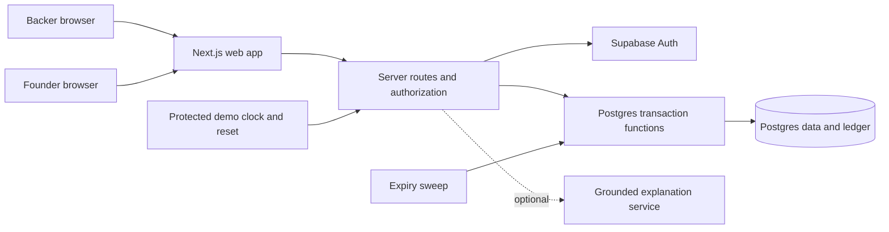

# HackNC 2026 — Early Startup Investing: Mega Plan

Repository: [avidnerd/hack-nc-2026](https://github.com/avidnerd/hack-nc-2026)  
Prepared: October 10, 2026  
Status: proposed product and build specification; no application implemented yet.  
Working name: **FirstStake** (team can replace this).

## 1. The project in one sentence

Build a web platform where people discover participating early startups, understand an investment opportunity, and explore buying a right to purchase shares later through a transparent, simulated option lifecycle.

The long-term ambition is wider access to startup investing. For HackNC, deliver a convincing interactive prototype using fictional startups, demo credits, and simulated ownership records. A company being pre-IPO does not mean it is approaching an IPO, and listing a company does not create permission to sell its shares.

**Recommended demo model:** a startup offers a fixed share quantity at a fixed exercise price until a deadline; a backer pays a separate upfront premium; later they exercise and pay the share purchase cost, or let the option expire and lose the premium. This is an implementation assumption, not a settled business model or validated legal instrument.

**The judge should be able to see:** a founder publishes terms → a backer understands the costs → the backer buys an option → the portfolio tracks its deadline → exercise produces simulated shares, while expiry produces no shares.

## 2. Assumptions and decisions to make first

The plan assumes three or four teammates, a web app, a US-oriented concept, and a 24-hour build window. HackNC's official website describes a 24-hour project challenge and recommends teams of three or four; the actual submission deadline and judging requirements must be checked with organizers. Use the relative schedule below against the time your team actually has left. [HackNC](https://hacknc.com/)

| Decision | Proposed starting point | Why / revisit trigger |
| --- | --- | --- |
| Investment instrument | Simulated company-issued option | Matches the user's example; change before implementing transactions if the team prefers equity or a SAFE |
| Audience | Curious backers and participating student/seed-stage founders | Manageable discovery interviews; broad public access is a long-term hypothesis |
| Market scope | Fictional participating startups | No unauthorized offerings or invented claims about real companies |
| Team and time | 3–4 people, 24 hours | Adjust ownership and scope immediately if different |
| Cash | Demo USD credits only | Keeps the core lifecycle demonstrable without payment or settlement dependencies |
| Units | Whole share quantities; all-or-nothing exercise | Makes allocation, deadlines, and settlement understandable |
| Premium | Per share; never credited against exercise cost | Avoids ambiguous pricing; make it explicit in every quote |
| Inventory | Dedicated share pool per offering | Prevents overlapping offers from allocating the same shares |
| Expiry | Fixed UTC timestamp; server-controlled | Avoids time-zone and client-clock ambiguity |
| Transferability | No transfers or secondary sales | A separate product and regulatory problem |
| Differentiator | Cost and scenario explorer + clear lifecycle | Useful, visible in a short demo, and feasible in one weekend |

First-hour decision: commit to one instrument for the demo. Do not support three investment models in the MVP.

## 3. Problem, value, and initial users

### Backer problem

Startup opportunities can be hard to discover and compare. A backer needs to distinguish money paid today, money required later, ownership received, and the possibility of losing money. A polished card with a low upfront price can obscure a much larger future purchase cost.

### Founder problem

A participating founder needs a clear way to publish terms and updates, track allocations, and understand what funding has actually arrived. An option premium is immediate simulated cash; a possible future exercise payment is contingent funding, not money already raised.

### Proposed value

- **Backers:** understandable terms, an interactive cost explorer, deadlines, and a record of what happened.
- **Founders:** a structured offering workflow and a dashboard separating premiums received, outstanding purchase rights, and exercise proceeds.
- **Judges:** a complete two-sided workflow with financial reasoning and transaction correctness visible on screen.

Start with people interested in supporting startups they understand. Avoid claiming that every startup can list or every person can legally participate in a real offering.

### Questions to validate

Interview three founders and five potential backers if time permits. Treat responses as qualitative feedback, not market proof.

1. Why would a founder sell future purchase rights instead of shares now?
2. Would a backer pay a premium knowing it may expire worthless?
3. Can the backer explain both payments after seeing the interface?
4. What information would they need about the company and share class?
5. Does a fixed deadline help the decision or create unwanted pressure?
6. Would a founder accept reserved equity without guaranteed future funding?

## 4. Compare the business models before committing

| Model | Backer receives | Founder receives | Product trade-off |
| --- | --- | --- | --- |
| Direct equity | Shares after a completed issuance | Purchase proceeds now | Easier ownership story; no buy-now/decide-later lifecycle |
| Company-issued purchase option | Contractual right to buy specified shares before a deadline | Premium now; exercise proceeds only if exercised | Distinctive demo; more contract, pricing, allocation, and settlement questions |
| SAFE or similar future-equity instrument | Contractual future-equity rights defined by its terms | Funding now | Does not work like a share option; conversion depends on the contract |
| Interest reservation | Expression of interest under specified terms | Demand signal; possibly no funding | Fast validation path; must not be described as actual ownership |

These are product comparisons, not a determination that any model qualifies for a particular offering exemption. The option model's legal classification, contract enforceability, and availability to retail backers require review before a real launch.

Keep a small instrument abstraction in the domain model (`instrument_type` and terms snapshot). Build only `SIMULATED_OPTION` now. Do not build a generic investment engine during the hackathon.

## 5. Option economics: make the math unambiguous

Use a fictional company, **Carolina Robotics**, with this illustrative offering:

| Term | Example |
| --- | --- |
| Shares covered by one purchase | 100 |
| Exercise price per share | $2.00 |
| Premium per share | $0.20 |
| Upfront premium | 100 × $0.20 = **$20.00** |
| Additional exercise payment | 100 × $2.00 = **$200.00** |
| Total paid if exercised | $20.00 + $200.00 = **$220.00** |
| Illustrative break-even share value | $220.00 / 100 = **$2.20** |
| Illustrative term | 90 days, represented by an exact expiry timestamp |

For quantity `q`, premium per share `p`, exercise price `k`, and hypothetical future share value `v`:

```text
premium_due_now = q × p
exercise_payment = q × k
total_paid_if_exercised = q × (p + k)
illustrative_share_value_after_exercise = q × v
illustrative_difference_after_exercise = q × v − q × k − q × p
expiry_outcome_if_never_exercised = −q × p
```

| Hypothetical share value | If exercised: illustrative difference versus total paid | If allowed to expire |
| --- | --- | --- |
| $1.00 | −$120 | −$20; no shares |
| $2.00 | −$20 | −$20; no shares |
| $2.20 | $0 | −$20; no shares |
| $5.00 | +$280 | −$20; no shares |

The illustration excludes taxes and other fees. A hypothetical value is not a market quote, a sale opportunity, or cash profit. Exercising does not produce liquidity. If exercised shares later become worthless, the backer may lose the entire $220, not just the premium. Private offerings can involve total loss, limited information, and indefinite holding periods. [Investor.gov private placements bulletin](https://www.investor.gov/introduction-investing/general-resources/news-alerts/alerts-bulletins/investor-bulletins/private-placements-under-regulation-d-updated-investor-bulletin)

The premium becomes a sunk cost after purchase. The interface can explain that exercise requires additional funds; it should not automatically recommend exercising based on a hypothetical value. Do not use public-market option pricing formulas to imply a reliable private-company option price.

### UX language

Use “Pay $20 now,” “Pay an additional $200 if you exercise,” and “You do not own shares yet.” After exercise: “100 simulated shares recorded.” At expiry: “Expired — $20 premium spent; no shares acquired.”

Avoid “guaranteed return,” “cash out,” “IPO soon,” “risk-free,” and “invest in any startup.” Show cost and loss scenarios as prominently as upside scenarios.

## 6. Product scope and priorities

### P0: required for a credible end-to-end demo

- Landing page explaining the product in plain language.
- Marketplace of six fictional startups, with search and sector filters.
- Startup detail page with a founder profile, metrics, updates, share class, and option terms.
- Interactive quantity and scenario calculator.
- Backer account with isolated demo credit balance.
- Server-generated purchase quote and confirmation.
- Persistent option purchase with allocation and wallet updates.
- Portfolio showing active options, deadlines, exercised simulated shares, and expired positions.
- Exercise flow requiring an additional debit and producing a simulated share position.
- Deterministic expiry behavior, including an explicit expired-option demo.
- Founder dashboard showing inventory, premiums, contingent proceeds, and completed exercise proceeds.
- Minimal founder create/publish flow using structured fictional data.
- Protected demo controls to reset a scenario and advance its clock.
- Hosted demo, a repeatable walkthrough, and a backup recording.

### P1: add only after P0 works

- Watchlist and in-app deadline notifications.
- Founder update publishing.
- Backer comparison of two opportunities using the same cost fields.
- An educational terms explainer using provided company information.
- Better founder draft validation and simulated admin review.
- Responsive polish, keyboard navigation, and chart accessibility improvements.

### P2: stretch ideas

- AI-generated plain-language explanations grounded in the offering's terms, with source links and a deterministic fallback.
- Scenario visualization for dilution and share-class differences, clearly marked as hypothetical.
- An exported transaction receipt.
- Analytics funnel dashboard with no unnecessary personal data.

### Beyond the hackathon

Real securities offerings, real payments or escrow, formal investor eligibility, identity checks, executed legal contracts, cap-table settlement, secondary trading, international participation, automated investment recommendations, and an actual compliance review process.

Blockchain and tokenization are optional technology choices. They do not resolve the legal or economic questions and are unnecessary for the core demo.

## 7. User journeys and screens

### Backer journey

1. Enter the demo and receive $1,000 in non-withdrawable demo credits.
2. Browse fictional startups and filter by sector.
3. Open Carolina Robotics and read its company story and terms.
4. Select 100 shares; see $20 due now, $200 due later, and the deadline.
5. Explore a downside and upside scenario without receiving an investment recommendation.
6. Confirm understanding that an option is not ownership and may expire worthless.
7. Buy the simulated option; see balance fall to $980 and an active position appear.
8. Open the portfolio and exercise before expiry.
9. Confirm a $200 debit; see balance fall to $780 and 100 simulated shares recorded.
10. Inspect a second, expired position to understand the alternative outcome.

### Founder journey

1. Sign in as a demo founder and create a fictional company profile.
2. Set a dedicated share pool, premium, strike, minimum/maximum quantity, sale close, and option expiry.
3. Preview the exact terms a backer will see.
4. Publish under demo-only validation rules.
5. Inspect the dashboard after a purchase: available shares decrease and reserved shares increase.
6. Inspect the dashboard after exercise: reservation moves to simulated issued shares; exercise proceeds appear separately.
7. Inspect expiry: reserved inventory is released, subject to whether the offering is still open for new purchases.

### Screen inventory

| Route | Key content | Primary action |
| --- | --- | --- |
| `/` | One-sentence pitch, three-step explainer, demo label | Explore startups |
| `/explore` | Company cards, sector filters, loading/empty states | View startup |
| `/startups/[slug]` | Company information, terms, calculator, updates | Get quote |
| `/checkout/[quoteId]` | Premium, exercise cost, expiry, terms version | Confirm simulated purchase |
| `/portfolio` | Balance, active rights, exercised shares, expired positions | View position |
| `/positions/[id]` | Snapshot of terms, transaction history, deadline | Exercise |
| `/founder` | Company, reserved/available/issued counts, proceeds | Create offering |
| `/founder/offerings/new` | Structured draft form and preview | Publish demo offering |
| `/demo` | Authorized scenario controls and reset | Advance demo clock |

Design direction: calm financial interface, readable numbers, one accent color, clear company cards, and a persistent “Simulation — fictional companies and demo credits” label. Use text/icons as well as color for position status. Do not show unsupported live stock charts or a fabricated portfolio return.

## 8. User stories with acceptance criteria

| Story | Acceptance criteria |
| --- | --- |
| As a backer, I can discover opportunities | Six seeded companies load; search and sector filters compose; empty states are understandable |
| As a backer, I understand the commitment | Quote shows quantity, premium, additional exercise payment, total cost, share class, and expiry |
| As a backer, I can buy an option | Successful transaction debits credits once, reserves inventory once, and persists after refresh |
| As a backer, I can exercise | Owned active option before expiry debits exercise cost once and creates one share position |
| As a backer, I can see expiry | At or after the deadline, exercise is rejected and eventual expiry releases reserved inventory exactly once |
| As a founder, I can publish | Only the founder's own company can be used; invalid dates, amounts, and quantities are rejected |
| As a founder, I understand proceeds | Premium receipts, potential exercise proceeds, and actual exercise proceeds are separate fields |
| As a teammate, I can repeat the demo | A protected reset restores deterministic fictional fixtures without touching another session |

## 9. Architecture recommendation

Use **Next.js + TypeScript**, **Supabase Postgres/Auth**, and **Vercel** unless the team already knows an alternative well. Keep one application and one database. The recommendation prioritizes team familiarity, one deployment, and transactional storage; it is not a claim that this is the only suitable stack.

Next.js supports the proposed app routing and server boundary; use its official documentation for the installed version. Supabase documents server-side auth, row-level security, and database functions. Vercel documents Next.js deployment. Pin the versions chosen at setup and avoid mid-event upgrades. [Next.js docs](https://nextjs.org/docs/app), [Supabase server-side auth](https://supabase.com/docs/guides/auth/server-side/nextjs), [Supabase RLS](https://supabase.com/docs/guides/database/postgres/row-level-security), [Supabase functions](https://supabase.com/docs/guides/database/functions), [Vercel docs](https://vercel.com/docs/frameworks/full-stack/nextjs)



### Boundaries and trade-offs

- Browser: displays terms and scenarios; sends identifiers and quantities, never authoritative prices or balances.
- Server: verifies identity, role, ownership, quote, and mutation permissions.
- Database transaction: atomically checks state, locks wallet/inventory/position, debits credits, and writes records.
- Authentication: provision separate backer/founder demo accounts; never let a client toggle grant founder/admin privileges.
- Expiry: synchronous deadline checks enforce correctness; a sweep updates stored state. A timer on the page is presentation only.
- Storage: fictional structured documents first; defer uploads and their access-control work.
- Optional AI: provides explanations from approved fields; cannot mutate investments, price options, or select “best” investments.

A managed backend saves setup time but introduces connectivity and service dependencies. Keep a separate local walkthrough with static fixtures as a presentation fallback. A static fallback must identify itself as a walkthrough; it should not imply persistence or completed transactions.

## 10. Domain and database model

Use UUID identifiers, integer cents, positive whole quantities, and UTC timestamps. The following schema is a proposed contract, not a migration that has already been implemented.

| Table | Important fields |
| --- | --- |
| `profiles` | `id` matching auth subject, display name, trusted role |
| `demo_scenarios` | `id`, authorized controller, clock offset, generation/reset version |
| `companies` | `id`, owner, slug, name, sector, description, fictional metrics, profile status |
| `offerings` | company, dedicated pool, instrument type, strike/premium cents per share, min/max quantity, sale close, expiry, status, terms version |
| `quotes` | investor, offering, quantity, price snapshot, terms version, quote expiry, scenario/generation, consumed position |
| `option_positions` | investor, offering, quantity, purchased terms snapshot, premium total, strike, expiry, ACTIVE/EXERCISED/EXPIRED, exercise time |
| `share_positions` | investor, company, share class, quantity, cost basis, originating option ID |
| `wallets` | investor/scenario, demo balance cents |
| `ledger_entries` | wallet, signed cents, PREMIUM/EXERCISE/SEED/REFUND type, position reference, timestamp |
| `transactions` | actor, idempotency key, operation, normalized request hash, result reference |
| `company_updates` | company, title, body, published time |
| `audit_events` | actor, action, entity, request ID, timestamp, non-sensitive metadata |

Scope demo accounts, wallets, quotes, and positions to a scenario where relevant. Company fixtures can be shared read-only or cloned into a scenario. Resets increment the scenario generation so stale quotes cannot be reused.

### Required invariants

1. `available + reserved_active + exercised_issued = dedicated_pool_total` for each offering. Expired positions are historical and no longer count in `reserved_active`.
2. `available`, `reserved_active`, `exercised_issued`, and demo wallet balances cannot become negative.
3. One option position can create at most one exercised share position.
4. Quote consumption happens at most once, including with a different idempotency key.
5. Premium and exercise debits have unique operation/position references.
6. Ledger sum matches stored wallet balance; a reconciliation check catches drift.
7. Published terms are immutable for purchased positions. Later founder edits cannot rewrite a purchase snapshot.
8. Founder metrics use successful transactions, not quoted or failed attempts.
9. All mutation attempts use authenticated ownership checks; database policy alone is not the entire transaction boundary.

A fixed exercise price does not prevent dilution or guarantee a percentage ownership. The share class and capitalization denominator matter; do not show an ownership percentage unless its assumptions are explicitly defined.

## 11. Lifecycle and transaction rules

### Offering lifecycle

`DRAFT → PUBLISHED → CLOSED`

Closing stops new sales. It does not cancel existing purchased rights. After publication, material term changes require a new version/offering; the MVP can simply prohibit edits to published financial terms.

### Position lifecycle

```mermaid
stateDiagram-v2
    [*] --> ACTIVE: Premium paid and inventory reserved
    ACTIVE --> EXERCISED: Before expiry; exercise payment succeeds
    ACTIVE --> EXPIRED: Effective time reaches expiry
    EXERCISED --> [*]
    EXPIRED --> [*]
```



The MVP uses immediate simulated settlement. Do not add pending real-payment states until actual asynchronous settlement is designed.

### Buy option: single atomic transaction

1. Verify session, scenario, request key, and positive quantity.
2. Check an existing idempotency result; reject reuse with a different payload.
3. Lock records in a consistent order and recheck the key after any wait.
4. Load the quote; verify investor, unconsumed status, scenario generation, terms version, quantity, and quote deadline.
5. Verify the offering is published, sale window open, and option not expired.
6. Check available inventory and the wallet balance.
7. Debit premium, move available inventory into active reservation, insert position, consume quote, append ledger/audit records, and store the request result.
8. Commit everything or roll everything back.

A quote is a short-lived pricing snapshot, not an inventory reservation. If shares run out between quote and purchase, return a clear inventory conflict without charging anything. A 60-second quote lifetime is sufficient for the demo; cap it at sale close and option expiry.

### Exercise: single atomic transaction

1. Verify the investor owns the position in the current scenario.
2. Lock the position and related wallet/inventory in the same documented lock order used across mutations.
3. Require ACTIVE and effective database time strictly less than expiry.
4. Compute the payment from the purchased terms snapshot.
5. Check funds; debit once; create the share record; move reserved inventory to exercised inventory; mark EXERCISED; append ledger/audit and idempotency records.
6. Commit, returning the resulting position and balance.

The premium is not refunded or deducted from the exercise payment. Insufficient funds leave the option ACTIVE if it has not expired. The user can choose to wait or let it expire.

### Expiry and the boundary race

At `effective_now >= expires_at`, exercise is forbidden even if the stored status still says ACTIVE. A sweeper locks due ACTIVE positions, changes them to EXPIRED, and returns inventory once. Exercise and expiry serialize on the same position lock, so only one terminal transition can win.

For the hackathon, run the expiry sweep through the protected demo clock control and a server-side portfolio refresh. For a real system, use a durable scheduled worker and monitor lag. Reads may present the effective expired state before the sweep finishes.

Expired inventory is available for new sales only if the sale window remains open and the new rights have a valid future expiry. For this fixed-expiry MVP, the original offering will ordinarily be closed when its positions expire.

### Demo clock

Derive effective time from database time plus a server-controlled scenario offset. Clients cannot supply time or change offsets. Advancement is forward-only within a scenario; reset creates a new generation. Display both the scenario time and actual demo label to prevent confusion.

## 12. API contracts

Use one documented API style; server route handlers are the proposed default. Successful mutations return the authoritative resulting state so the UI can refresh immediately.

| Endpoint | Request | Behavior |
| --- | --- | --- |
| `GET /api/startups` | Search/sector query | Paginated published fictional companies |
| `GET /api/startups/:slug` | Slug | Profile, updates, published offering, terms |
| `POST /api/quotes` | Offering ID, quantity | Validated cost snapshot and short deadline |
| `POST /api/options` | Quote ID; idempotency header | Atomic premium debit and reservation |
| `GET /api/portfolio` | Authenticated session | Own wallet, rights, shares, transaction history |
| `POST /api/options/:id/exercise` | Idempotency header | Atomic debit and simulated share issuance |
| `POST /api/founder/offerings` | Company ID, structured draft terms | Validate ownership and save DRAFT |
| `POST /api/founder/offerings/:id/publish` | Draft version | Validate and publish immutable terms |
| `GET /api/founder/dashboard` | Session | Own company inventory and proceeds |
| `POST /api/demo/advance` | Scenario ID, authorized forward offset | Advance server clock and sweep expiry |
| `POST /api/demo/reset` | Scenario ID | Authorized deterministic reset/generation change |

Example purchase quote response:

```json
{
  "quoteId": "example-uuid",
  "quantity": 100,
  "premiumDueNowCents": 2000,
  "additionalExercisePaymentCents": 20000,
  "totalPaidIfExercisedCents": 22000,
  "termsVersion": 1,
  "quoteExpiresAt": "ISO-8601 UTC timestamp",
  "optionExpiresAt": "ISO-8601 UTC timestamp",
  "simulation": true
}
```

Error responses use a stable code, human-readable message, and request ID. Examples: `UNAUTHENTICATED`, `FORBIDDEN`, `INVALID_QUANTITY`, `QUOTE_EXPIRED`, `TERMS_CHANGED`, `INSUFFICIENT_CREDITS`, `INVENTORY_UNAVAILABLE`, `OPTION_EXPIRED`, and `IDEMPOTENCY_CONFLICT`. Use appropriate HTTP status codes; never return a successful-looking receipt for a failed mutation.

## 13. Access control and data integrity

- Public/demo discovery reads published fictional profiles and terms.
- Backers read only their own wallets, ledger entries, quotes, options, and shares.
- Founders edit only companies they own and read aggregated results for their offerings.
- Users cannot self-assign trusted roles or edit monetary/inventory columns directly.
- Enable RLS on exposed tables and define explicit policies. Privileged server credentials must stay on the server. [Supabase RLS documentation](https://supabase.com/docs/guides/database/postgres/row-level-security)
- Make ledger, wallet, inventory, and position mutations available only through authorized transaction functions/server operations. If a function uses elevated database privileges, restrict invocation, check identity within it, and set a safe search path. [Supabase database functions](https://supabase.com/docs/guides/database/functions)
- Validate same-origin requests and session authentication on browser mutations; use the framework's supported protections.
- Avoid public reset endpoints or shared admin secrets shipped to the browser.
- Log request IDs and transitions; omit auth tokens and unnecessary personal information.
- Add basic request limits to quote creation and demo reset if the app is publicly accessible.

This is the minimum integrity work for the proposed transaction demo. It is not a production security certification.

## 14. Fictional seed data and demo fixtures

Create six clearly fictional startups across robotics, climate, health software, education, agriculture, and developer tools. Give each a distinct description and a few invented metrics explicitly labeled as demo data.

For Carolina Robotics, reserve a dedicated pool of 10,000 simulated shares. Seed two backer scenarios so the exercise demonstration cannot accidentally expire the other presenter's position.

| Fixture | Purpose |
| --- | --- |
| Founder with one published offering | Immediate marketplace content and founder dashboard |
| New backer with $1,000 demo credits | Purchase and exercise flow |
| Backer with an active near-expiry option | Deadline and expiry flow |
| Closed offering | Disabled new-purchase state |
| Small inventory pool | Oversubscription/concurrent purchase verification |
| Low-balance wallet | Insufficient-funds verification |

Use relative timestamps generated at reset. Keep company descriptions and offering terms in a typed seed definition shared with the demo script. No real founder names, funding claims, or company logos are required.

## 15. GitHub organization and proposed file structure

This repository currently begins with a README and license. Add implementation folders only as they are built; the structure below is a recommendation.

```text
app/                       pages and server route handlers
components/                reusable UI and financial display components
lib/auth/                  sessions, ownership, and trusted roles
lib/domain/                money, terms, scenarios, lifecycle definitions
lib/db/                    server database access
supabase/migrations/       versioned schema, policies, transaction functions
supabase/seed.sql           deterministic fictional demo data
tests/domain/              meaningful money and lifecycle cases
tests/integration/         transaction, authorization, and concurrency checks
tests/e2e/                 backer and founder demo paths
docs/MEGA_PLAN.md           this plan
README.md                  project entry point and verified setup instructions
.env.example               variable names only; no secrets
```

Workflow: short feature branches, small pull requests, and a build/typecheck on each merge candidate. Establish `main` as the last working integrated demo. Assign one integration owner who resolves shared interfaces and checks the deployed flow.

Use issue titles and acceptance criteria from the backlog below. If the team enables a project board, use **Ready → In progress → Review → Done**, with at most one active implementation task per teammate. Assign real names only after the team confirms ownership.

## 16. Execution backlog and dependency order

Estimates are rough person-hours, not guarantees. Each row is a ready-to-create GitHub issue; the full set should not be attempted if the remaining event time is shorter than the assumed window.

| ID | Priority | Issue / deliverable | Owner role | Depends on | Estimate | Done when |
| --- | --- | --- | --- | --- | --- | --- |
| H01 | P0 | Agree demo instrument and freeze terms | Whole team | — | 0.5 | Example and rules approved; no ambiguity about the two payments |
| H02 | P0 | App shell and first hosted deployment | Frontend/integration | H01 | 1.5 | Shared navigation and a deployed placeholder work |
| H03 | P0 | Schema, auth, policies, and fixtures | Backend | H01 | 3 | Seeded accounts and isolation checks work |
| H04 | P0 | Marketplace and startup detail | Frontend | H02; H03 API contract | 3 | Six startups, filtering, terms, and empty states work |
| H05 | P0 | Cost/scenario explorer and quote API | Domain/backend + frontend | H01; H03 | 2 | Example arithmetic matches; quote authority is server-side |
| H06 | P0 | Atomic simulated option purchase | Backend | H03; H05 | 3 | Purchase persists; retries and low funds cannot double-debit |
| H07 | P0 | Portfolio and receipts | Frontend | H04; H06 | 2 | Own active options, balance, and terms snapshots render |
| H08 | P0 | Exercise transaction and confirmation | Backend + frontend | H06; H07 | 3 | Credits and simulated shares update exactly once |
| H09 | P0 | Expiry sweep and protected demo clock | Backend | H06 | 2 | Boundary rejection and single inventory release verified |
| H10 | P0 | Founder draft, publish, and dashboard | Founder UX | H02; H03; H06 | 3 | Ownership, terms validation, and proceeds categories work |
| H11 | P0 | Critical verification and integration fixes | Integration | H06–H10 | 3 | Correctness checklist and hosted happy paths pass |
| H12 | P0 | Pitch, recording, and submission package | Product/integration | H04; H07; H10 | 2 | Rehearsed demo and organizer-required materials ready |
| H13 | P1 | Watchlist and in-app deadline alerts | Frontend | H07; H09 | 2 | Alerts refer to the right owned positions |
| H14 | P1 | Grounded educational explainer | Available teammate | H04; H05 | 2 | Uses supplied terms; no invented facts; fallback works |

Critical path: **H01 → H03/H05 → H06 → H08/H09 → H11 → H12**. Build the interface against agreed fixtures while the backend is being implemented, then replace fixtures at the first integration checkpoint.

### Issue template

```text
Title: [P0] H06 — Atomic simulated option purchase
Outcome: A backer can buy one option without duplicate charges or oversold inventory.
Scope: Quote validation, wallet debit, reservation, position, ledger, receipt.
Dependencies: H03, H05.
Acceptance: Successful purchase persists; insufficient funds and stale quotes do not mutate state;
            retries return the existing receipt; concurrent requests preserve inventory.
Verification: Demonstrate the acceptance cases against the database, not only mocked UI.
```

## 17. Team responsibilities

| Role | Primary ownership | Must coordinate with |
| --- | --- | --- |
| A: backer/frontend | Marketplace, detail, calculator, checkout, portfolio | B on response formats and state refresh |
| B: backend/domain | Schema, auth, quotes, ledger, purchase, exercise, expiry | Everyone on model and authorization |
| C: founder/product | Founder form/dashboard, copy, fictional data, validation interviews | B on publishing and metrics; D on pitch |
| D: integration/demo | Deployment, critical checks, integration, recording, submission | All owners at checkpoints |

For three people, combine C and D; A and B help with integration. For two people, seed founder terms and make the founder view read-only for the presentation, then focus on the backer lifecycle. Explicitly disclose any seeded workflow instead of presenting it as a completed publishing feature.

## 18. The 24-hour build schedule

| Elapsed time | Work | Exit criterion |
| --- | --- | --- |
| 0–1h | Pick model, write example terms, choose stack, assign ownership | Everyone can describe the same transaction |
| 1–3h | Deploy shell; schema/auth/fixtures; UI layout and pitch outline | Hosted site and agreed API shapes exist |
| 3–6h | Marketplace, details, calculator, quote, purchase backend | First durable purchase works |
| 6–10h | Connect checkout, portfolio, founder totals | One backer purchase visible on both sides |
| 10–14h | Exercise, expiry, protected clock/reset; founder publish | Complete lifecycle works locally |
| 14–17h | Concurrency/authorization checks; deployed integration | Critical invariants hold in hosted demo |
| 17–20h | User clarity check, responsive polish, accessible statuses | Test users explain both payments correctly |
| 20–22h | Record demo, finish README and submission materials | Backup recording and required fields ready |
| 22–24h | Feature freeze, rehearse, fix only blocking bugs, submit | Two repeatable walkthroughs completed |

Do not wait until the final hours to deploy. Check integration around hours 3, 6, 10, 14, and 17. Each checkpoint should demonstrate a working behavior, not just report code completion.

### If time is running out

- **12 hours left:** keep discovery, calculator, purchase, exercise, expiry, and a seeded founder dashboard; cut AI, watchlists, uploads, and elaborate publishing.
- **6 hours left:** one fictional startup, one backer account, one durable lifecycle, protected reset, and a clear pitch.
- **3 hours left:** stop expanding scope; stabilize the working path, capture a recording, and prepare submission.

The minimum defensible transaction demo still needs correct balances, deadlines, inventory, and ownership checks. If those are incomplete, present it honestly as an interactive concept walkthrough.

## 19. Verification that matters

The task list here describes tests to implement with the app. No runtime checks have been performed yet because this deliverable is a plan.

### Domain cases

- 100 × 20 cents premium = 2,000 cents; 100 × 200 cents strike = 20,000 cents; total 22,000 cents.
- Reject zero, negative, fractional, out-of-range, and overflow-sized quantities.
- Exercise before expiry succeeds; at or after expiry fails.
- Break-even and scenario values display consistent units; hypothetical values never appear as realized cash.

### Transaction and authorization cases

| Case | Expected result |
| --- | --- |
| Duplicate purchase with same key | Same result; one debit and one reservation |
| Same key, different request | Conflict; no additional mutation |
| Same quote, different key | Existing purchase or conflict; no second charge |
| Two requests for last available shares | At most the available quantity allocated; losing request is not charged |
| Two exercise requests | One share position and one exercise debit |
| Exercise racing expiry | One terminal state; inventory and ledger stay consistent |
| Failure between writes | Entire transaction rolls back |
| Backer requests another portfolio | Denied |
| Founder changes another company's terms | Denied |
| Client attempts direct wallet/inventory edit | Denied |
| Client changes price or clock | Ignored/rejected; server remains authoritative |
| Founder closes offering with active options | New purchases stop; valid existing options can still exercise |
| Reset followed by stale quote | Rejected due to scenario generation mismatch |

### End-to-end acceptance

Run the backer purchase → exercise path, the expiry path, and founder totals on the hosted deployment. Refresh during each path to verify persistence. Check narrow-screen usability, keyboard use, visible loading/errors, and no exposed server secrets. Two teammates should independently run the presentation with a fresh reset.

Aim for under three seconds per interaction on the demo network and support roughly 20 simultaneous demo users. These are internal targets to verify, not measured performance or promised service levels.

## 20. Demo and pitch: three minutes

| Time | Presenter action | Message |
| --- | --- | --- |
| 0:00–0:20 | Show landing page | “We're exploring clearer access to participating early startups.” |
| 0:20–0:50 | Open Carolina Robotics | “Here is the company information and the exact offer.” |
| 0:50–1:20 | Set 100 shares; show downside/upside | “Pay $20 now; an additional $200 is needed to buy the shares.” |
| 1:20–1:45 | Confirm purchase; open portfolio | “The backer owns a purchase right, and the system reserves its allocation.” |
| 1:45–2:10 | Exercise; show share record | “The additional payment creates simulated ownership, with a persistent receipt.” |
| 2:10–2:30 | Show separate expired scenario | “If the backer lets it expire, they lose the premium and receive no shares.” |
| 2:30–2:45 | Show founder dashboard | “The founder sees premiums, contingent proceeds, and exercise proceeds separately.” |
| 2:45–3:00 | Close with next step | “We built the workflow; our next step is validating the instrument and eligible participation with founders and a regulated partner.” |

Potential differentiators to highlight: the two-payment explanation, honest scenario labeling, atomic inventory handling, visible exercise/expiry states, and a founder view tied to actual completed transactions.

### Judge questions to prepare for

- **Is this real investing?** The HackNC demo uses fictional companies and credits. A real offering would require a valid instrument and compliant offering/settlement route.
- **Why would founders use options?** The hypothesis is early premium proceeds and a community of interested backers; the trade-off is reserved equity and uncertain exercise funding.
- **What happens without an IPO?** The option still follows its contractual deadline in the proposed model; exercised shares may remain illiquid indefinitely.
- **What happens if the company fails?** Unexercised rights can become worthless; exercised shares can also lose all value.
- **How are prices set?** Founder-entered demo terms. Real pricing would require diligence and agreement, not a guaranteed valuation algorithm.
- **How is this different from crowdfunding?** Our prototype focuses on explaining and tracking a future purchase right. A real implementation may need a crowdfunding or other securities offering route; the interface alone does not create an exemption.

## 21. Real-launch feasibility workstream

The product concept itself raises legal and operational questions that affect the design. Treat them as decisions to investigate after the demo, not as solved by a disclaimer.

In the US, Regulation Crowdfunding is one possible route for eligible offerings: it requires a registered intermediary, disclosures, and limits for non-accredited investors, and generally restricts resale for a year. That does not establish that this proposed option qualifies. [SEC Regulation Crowdfunding overview](https://www.sec.gov/resources-small-businesses/exempt-offerings/regulation-crowdfunding)

SEC guidance also states that funding portals cannot provide investment advice/recommendations or hold/manage investor funds or securities. That distinction affects future AI features, money movement, and partner selection. [SEC funding portal guide](https://www.sec.gov/files/divisions/marketreg/tmcompliance/fpregistrationguide.htm)

### Questions before accepting real funds

1. Is the issuer selling a new company-issued option, a warrant, a reservation, or someone else's existing shares?
2. What approvals and share authorization support issuance and exercise?
3. Which registration/exemption and intermediary route applies to both the right and underlying shares?
4. Who can participate, in which jurisdictions, and under which limits or verification requirements?
5. What share class, voting rights, dilution treatment, corporate actions, and transfer restrictions apply?
6. What happens at expiry, company failure, acquisition, cancellation, or issuer inability to issue shares?
7. Who handles funds, refunds, reconciliation, signed contracts, custody where applicable, and cap-table updates?
8. Which identity, fraud, tax reporting, privacy, and record-retention requirements apply?
9. How are transaction fees and the platform's compensation structured under the chosen route?

Recommended post-event sequence: obtain counsel's instrument analysis → interview suitable registered partners → choose a compliant operating model → map eligibility/settlement APIs → implement and test against that contract → conduct a limited pilot. Do not enable live checkout merely by swapping demo credits for a payment button.

## 22. Business model and adoption hypotheses

Start by validating founder demand, not by building a broad exchange. Potential channels include campus entrepreneurship groups, incubators, and founder communities willing to discuss the concept. These are proposed channels, not existing partnerships.

Potential revenue models to investigate: founder software subscriptions, administration/service fees, or partner-compatible transaction fees. Do not pick a transaction-based fee before reviewing the platform's regulatory role. Keep platform fees at zero in the simulated MVP so the two core payments stay clear.

Unit-economics worksheet for a future pilot:

```text
net contribution per company
  = software/service revenue + permitted transaction revenue
  − partner costs − identity/verification costs − support costs
  − payment/settlement costs − allocated compliance costs
```

Founder option proceeds should be modeled separately:

```text
premium proceeds = successfully purchased quantity × premium per share
contingent exercise proceeds = active reserved quantity × strike per share
completed exercise proceeds = exercised quantity × strike per share
```

Do not include contingent proceeds in cash raised. An illustrative 1,000-share purchase at a $0.20 premium and $2.00 strike produces $200 now and up to $2,000 later if all rights are exercised.

### Validation metrics

- Can at least four of five test backers correctly explain the premium, exercise payment, and expiry?
- Can each presenter complete the main flow without intervention?
- Do founder interviewees describe a plausible reason to reserve equity for this arrangement?
- Can users find and understand the share class and total cost?
- Do transactions reconcile after retries, expiry, and reset?

These are proposed gates. Record actual results separately and avoid claiming adoption, traction, or returns from demo activity.

## 23. Risks and contingency plan

| Risk | Observable signal | Response |
| --- | --- | --- |
| Instrument choice stays unresolved | Team uses incompatible terms | Freeze one simulated contract in hour one |
| Backend integration slips | Purchase exists only as UI state | Cut P1/P2; integrate one durable path |
| Option UI confuses users | They think premium buys shares | Rewrite checkout around two payments and current ownership |
| Inventory or ledger drifts | Invariants fail after retry | Stop feature work; fix atomic transaction boundary |
| Founder funding story overstated | Dashboard counts future payments as raised | Separate contingent proceeds from received proceeds |
| Network/service outage | Hosted demo fails | Use recording or labeled local walkthrough |
| Expiry affects other presenters | Shared scenario unexpectedly advances | Use isolated scenarios and protected controls |
| AI invents company information | Explanation lacks support | Disable AI and use deterministic terms explanations |
| Public demo is mistaken for an offering | Real company/cash language appears | Keep fictional data, credits, and simulation labeling explicit |
| Submission rules are missed | Unknown required artifact/deadline | Check organizers' instructions early and again before submission |

## 24. Completion checklist and post-hackathon roadmap

### Hackathon definition of done

- [ ] Team confirms the demo instrument and rules.
- [ ] Hosted app has fictional startup discovery and complete cost disclosure.
- [ ] A purchase persists and respects balance/inventory limits.
- [ ] Exercise debits the additional amount and records simulated shares.
- [ ] Expiry produces no shares and releases reservations once.
- [ ] Backer data and founder editing are properly isolated.
- [ ] Founder proceeds and inventory agree with completed transactions.
- [ ] Protected reset produces a repeatable scenario.
- [ ] Critical verification passes on the hosted environment.
- [ ] README contains verified setup instructions, actual feature status, and demo access guidance.
- [ ] Three-minute walkthrough is rehearsed; backup recording exists.
- [ ] Organizer-required submission materials are completed before the actual deadline.

### After HackNC

| Stage | Work | Decision gate |
| --- | --- | --- |
| Week 1 | Founder/backer interviews; analyze whether the option mechanism solves a real problem | Users understand and want the proposed workflow |
| Weeks 2–4 | Instrument and intermediary review; evaluate direct equity/SAFE alternatives | Identified legal/operating route and partner feasibility |
| Following prototype cycle | Expand contract states, settlement reconciliation, disclosures, and audit retention | End-to-end partner sandbox behavior validated |
| Before a real pilot | Formal security/operational review, approved documents, eligibility, settlement and support process | Authorized, monitored pilot with limited scope |
| Only after pilot evidence | Broader issuer onboarding, performance scaling, expanded jurisdictions | Demonstrated demand and compliant operational capacity |

As usage grows, revisit transactional contention, durable expiry jobs, pagination/indexes, backup restoration, reconciliation alerts, and partner outages before adding caches or services. Keep financial state strongly consistent; caches can accelerate discovery but cannot authorize purchases.

**Immediate next task:** settle the simulated instrument, assign H02 and H03, and deploy the first shared shell. This document is the planning artifact; the unchecked items above represent work still to build.
